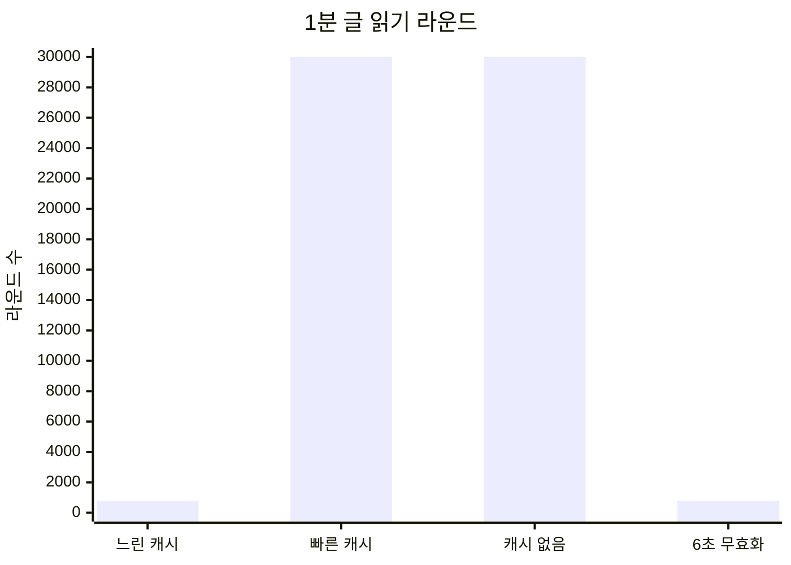
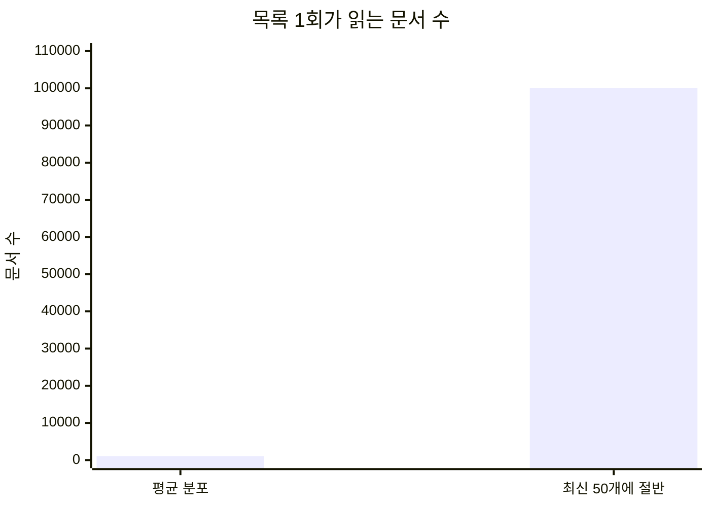
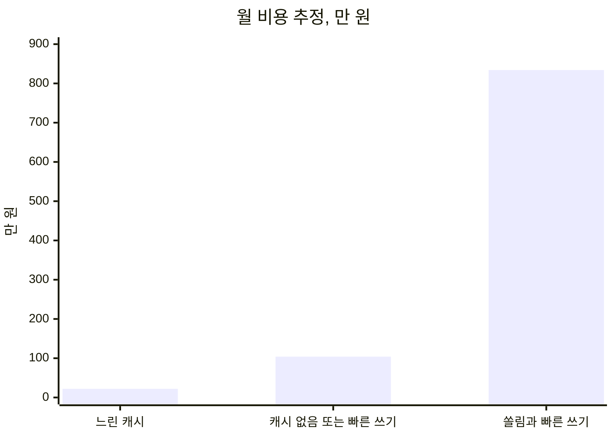

# 2026-11-05 글 캐시 비교

- 날짜: 2026-11-05
- 앱: `lgcns-fe-next`
- 기준 코드: `lib/postCache.ts`, `service/postService.ts`의 `listPosts`와 `getPost`, `actions/postActions.ts`의 `updateTag("posts")`, `lib/currentUser.ts`
- 이 문서는 그 코드의 쿼리 모양으로 센 추정치다. 만 명 데이터를 넣고 부하 테스트를 돌린 결과는 아니다.
- 실측은 로컬 개발 서버의 `GET /posts` 세 번이다. 함수 본문 로그는 첫 요청에만 새 시각으로 찍혔고, 다음 두 요청은 같은 시각을 `Cache` 접두로 재생했다. 그 두 요청에서는 `getCachedPosts` 안의 Prisma가 다시 실행되지 않았다.

빠른 갱신에서 캐시가 더 느려지는 것은 아니다. 글 읽기가 데이터베이스에 가는 횟수가 캐시를 껐을 때와 같아진다. 무효화를 6초마다 한 번으로 묶으면 글 읽기만 느린 캐시 수준으로 돌아온다. 쓰기 횟수는 줄지 않는다. 읽기 복제본은 캐시 히트를 만들지 않고, 미스난 읽기의 위치만 옮긴다.

## 1. 가정

데이터는 사용자 10,000명, 글 10,000개, 댓글 100,000개, 좋아요 100,000개다. 글 하나당 평균 댓글 10개, 좋아요 10개다. 활성 사용자 5,000명이 같은 1분 동안 목록을 한 번, 글 상세를 한 번 연다. 서버는 메모리가 요청 사이에 유지되는 프로세스 하나다. 인스턴스가 늘면 아래 데이터베이스 횟수에 인스턴스 수를 곱한다.

목록은 글 10,000개를 읽지 않는다. `listPosts`는 `createdAt` 내림차순 50개만 읽고, 그 50개의 댓글 전부와 좋아요 전부를 읽는다. 한 번을 채울 때 라운드는 3번이다. 상세 `getPost`도 3번이다. `findSessionUser`는 `use cache` 밖에 있어 로그인된 목록·상세마다 사용자 1건을 찾는다. 1분에 10,000번이고 캐시를 켜도 그대로다.

`getCachedPosts`와 `getCachedPost`는 태그 `"posts"` 하나와 `cacheLife("max")`를 쓴다. `max`의 서버 재검증은 30일, 만료는 1년이다. 글 작성, 수정, 삭제, 댓글, 좋아요가 성공하면 모두 `updateTag("posts")`를 호출한다. 쓰기 한 번이 목록과 모든 글 상세 캐시를 함께 지운다. 저장소는 기본 인메모리 LRU다. 응답의 `Cache-Control: no-store`는 브라우저에 HTML을 저장하지 말라는 뜻이라 서버 메모리 캐시와 별개다.

느린 캐시의 780은 목록 30라운드에 상세 중간값 750라운드를 더한 것이다. 상세가 한 글에 모이면 합계는 약 33까지 내려가고, 6초마다 열린 글이 전부 다르면 약 1,530까지 올라간다. 6초 무효화는 지금 코드가 아니다. 쓰기는 1분에 5,000번 그대로 두고 태그만 6초마다 한 번 지운다고 둔 값이다.

## 2. 비교

| 조건 | 쓰기 / 분 | 글 읽기 라운드 / 분 | 캐시가 줄이는 양 |
| --- | --- | --- | --- |
| 느린 캐시. 쓰기 10회 | 10 | 약 780 | 30,000에서 780으로 준다 |
| 빠른 캐시. 지금 코드 | 5,000 | 약 30,000 | 없다. 캐시 없음과 같다 |
| 캐시 없음 | 5,000 | 약 30,000 | 비교 기준 |
| 빠른 쓰기 + 6초마다 한 번만 무효화 | 5,000 | 약 780 | 읽기만 느린 캐시와 같다. 쓰기는 줄지 않는다 |

쓰기가 1분에 10번이면 무효화 간격이 약 6초다. 그 사이 목록 읽기 약 500번이 메모리 한 건을 나눠 쓴다. 목록 라운드는 15,000번에서 약 30번으로 준다.

쓰기가 1분에 5,000번이면 간격이 약 12밀리초다. 그 사이 목록 읽기는 평균 1번이다. 방금 채운 값을 다음 읽기가 거의 쓰지 못한다. 목록과 상세를 합친 글 읽기는 캐시 없음과 같은 약 30,000라운드다.

평균 분포에서 목록 한 번이 읽는 문서는 약 1,050개다. 캐시가 없으면 1분에 약 525만 문서다. 느린 캐시나 6초 무효화는 채우기가 약 10번이라 약 1만 문서다. 최신 50개 글에 댓글·좋아요의 절반이 몰리면 목록 한 번이 약 10만 문서다. 빠른 캐시와 캐시 없음은 1분에 그 채우기가 5,000번이라 약 5억 문서다. 6초 무효화면 약 100만 문서다.

## 3. 캐시의 장점과 단점

장점은 쓰기가 드물 때만 생긴다.

- 목록 조회가 1분에 약 15,000라운드에서 약 30라운드로 줄어든다.
- 히트한 요청은 `getCachedPosts` 안의 Prisma를 실행하지 않는다. 로컬에서 이어진 `GET /posts`가 같은 시각 로그를 `Cache`로 재생한 것이 이 경우다.
- 쓰는 사람이 없으면 `cacheLife("max")`의 서버 재검증 30일까지 그 메모리 값을 유지한다.
- 그 조건의 월 비용은 약 22만 원이다. 캐시 없음의 약 104만 원보다 약 82만 원이 적다.

단점은 태그가 `"posts"` 하나인 데서 생긴다.

- 좋아요, 댓글, 작성, 수정, 삭제가 목록과 모든 글 상세 캐시를 함께 지운다. 다른 글의 좋아요도 보고 있던 글의 캐시를 지운다.
- 쓰기가 읽기만큼 잦으면 글 읽기 횟수는 캐시가 없을 때와 같다. 월 비용도 약 104만 원으로 같다.
- 목록 캐시에는 최신 50개 글의 댓글 본문이 들어 있다. 미스가 날 때마다 그 본문을 다시 받는다.
- 로그인 사용자 조회는 캐시 밖에 있어 1분에 10,000번 남는다.
- 응답의 `Cache-Control: no-store` 때문에 브라우저는 이 HTML을 저장하지 않는다.
- `cacheLife("max")`의 30일은 그 사이에 쓰기가 없을 때의 수명이다. 1분에 쓰기가 수천 번이면 그 시간에 도달하지 않는다.

## 4. 무효화를 6초마다 한 번으로 묶으면

글 읽기는 돌아온다. 쓰기는 돌아오지 않는다.

지금 액션은 좋아요 한 번, 댓글 한 번에 `updateTag("posts")`를 호출한다. 이 호출을 6초마다 한 번으로 묶으면 무효화는 1분에 10번이 된다. 간격이 느린 갱신과 같아서 글 읽기 약 30,000라운드가 약 780라운드로 줄어든다. 2절 그래프의 마지막 막대다.

좋아요 5,000번은 각각 `findUnique` 다음 `delete` 또는 `create`다. 태그만 늦추면 이 5,000번은 프라이머리에 남는다. 평균 분포에서 클러스터는 M30보다 낮아질 수 있다. M10으로 단정하지 않는다. 초당 쓰기 약 80회와 사용자 조회 약 170회가 남기 때문이다.

보는 사람은 최대 6초 동안 이전 좋아요 수와 댓글을 본다. 지금 `updateTag`는 그 다음 읽기가 방금 쓴 값을 보게 한다. 6초 배치는 그 즉시성을 버린다. 이 배치는 현재 코드에 없다.

쓰기 문서를 모았다가 한 번에 insert하는 배치는 쓰기 라운드를 줄인다. 그때도 항목마다 `updateTag`를 호출하면 캐시는 다시 매 항목마다 지워진다. 캐시 성능을 올리는 쪽은 쓰기 배치가 아니라 무효화 배치다.

## 5. 읽기 전용 데이터베이스

읽기 복제본은 캐시 히트를 더 빠르게 만들지 않는다. 히트는 이미 앱 메모리이고 데이터베이스를 부르지 않는다.

미스가 난 읽기를 세컨더리로 보낼 수는 있다. 지금 `PrismaClient`는 읽기 선호가 프라이머리인 기본값이다. 복제본을 쓰려면 그 설정을 바꿔야 한다. Atlas 전용 클러스터 요금에는 이미 노드 3개의 복제 세트가 들어 있다. 세컨더리에서 읽게 하는 것만으로 같은 등급 요금이 한 번 더 나오지는 않는다. 분석용 노드를 추가하면 그때 요금이 늘어난다.

빠른 갱신에서 매 쓰기마다 태그를 지우면 글 읽기 약 30,000라운드는 거의 전부 미스다. 그 읽기를 세컨더리에 두면 프라이머리는 쓰기와, 프라이머리에 남긴 사용자 조회를 담당한다. 읽기 총량은 줄지 않는다. 평균 분포면 그 읽기 노드도 M30에 가깝다. 최신 50개에 절반이 몰리면 세컨더리도 그 문서 전송을 감당해야 한다.

복제 지연이 있다. 태그를 지운 직후 세컨더리에서 다시 채우면, 방금 누른 좋아요가 아직 없는 값을 캐시에 넣을 수 있다. 그 값이 다음 무효화까지 메모리에 남는다. 6초 무효화와 복제 지연을 같이 쓰면 화면이 늦는 시간은 두 지연을 더한 만큼이다. 본인 쓰기를 바로 보여 주려면 그 읽기만 프라이머리로 보내야 한다.

## 6. 비용

월 요금은 피크 1분을 버티는 클러스터를 한 달 내내 켜 두는 비용이다. 환율은 1달러에 1,400원이다. 데이터베이스 단가는 MongoDB Atlas AWS us-east-1 전용 클러스터의 2026-09-29 공개 시간당 요금에 730시간을 곱한 것이다. M10은 시간당 0.08달러로 약 57달러, M30은 시간당 0.54달러로 약 394달러, M80은 시간당 7.30달러로 약 5,329달러다. 스토리지를 키우거나 백업, 리전 밖 전송, 서포트는 포함하지 않는다.

인프라는 앱용 소형 가상서버 1대를 월 30달러로 둔 가정이다. 운영은 장애와 슬로 쿼리를 보는 사람 시간을 시급 5만 원으로 둔 가정이다.

| 구분 | 느린 캐시, 평균 분포 | 캐시 없음, 또는 빠른 캐시, 평균 분포 | 최신 50개에 절반이 몰리고 쓰기가 빠를 때 |
| --- | --- | --- | --- |
| 데이터베이스 | M10. 초당 포인트 조회 약 170회. 약 8만 원 | M30. 초당 조회 약 670회에 쓰기가 더해진다. M10·M20은 버스트 CPU라 지속 부하에서 제한된다. 약 55만 원 | M80을 하한으로만 적는다. 목록 1회가 약 10만 문서이고 1분에 5,000회다. 약 746만 원. 이 등급으로 그 전송량이 처리된다고 보지 않는다 |
| 인프라 | 앱 서버 1대. 약 4만 원 | 앱 서버 2대. 약 8만 원. 데이터베이스가 병목이면 서버를 더 늘려도 조회 비용은 줄지 않는다 | 앱 서버 2대. 약 8만 원 |
| 운영 | 월 2시간. 약 10만 원 | 월 8시간. 약 40만 원 | 월 16시간. 약 80만 원 |
| 월 합계 | 약 22만 원 | 약 104만 원 | 약 834만 원 |

느린 캐시와 캐시 없음의 차이는 한 달에 약 82만 원이다. 대부분은 데이터베이스를 M10에 둘 수 있는지, M30을 한 달 내내 켜야 하는지에서 나온다. 빠른 캐시는 캐시 없음과 같은 약 104만 원이다. 6초 무효화는 글 읽기만 느린 캐시로 되돌린다. 쓰기 5,000회가 남아 M10으로 단정하지 않는다.
